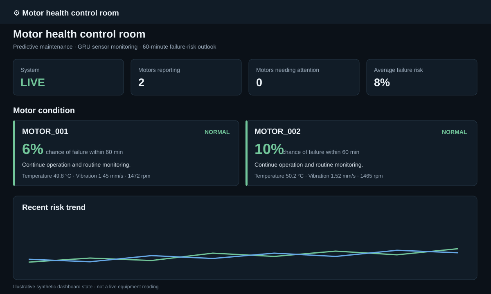
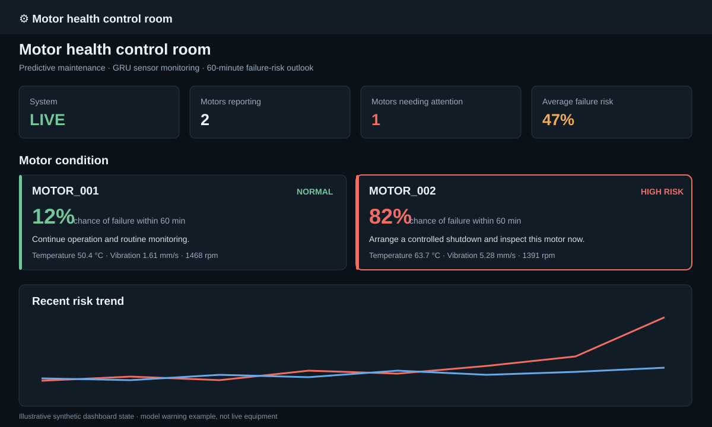

# Motor Health Sensor Monitor

A small predictive maintenance demo that streams synthetic motor telemetry, trains a GRU classifier, and displays a live failure-risk estimate in Streamlit. It is intended for learning and demonstration; it does not connect to real equipment.

## Screenshots

These dashboard state illustrations show the intended normal and alert views. The failure alert is a simulated model prediction.

| Normal operation | Failure warning |
| --- | --- |
|  |  |

## Requirements

- Python 3.10 or newer
- Packages in `requirements.txt`

Install dependencies from this directory:

```powershell
python -m pip install -r requirements.txt
```

## Train the model

The included `synthetic_motors.csv` is used for training. Training writes `models/motor_gru.pt` by default.

```powershell
python model.py train --epochs 15
```

To choose a different training file or model output:

```powershell
python model.py train --data synthetic_motors.csv --model-path models/motor_gru.pt --epochs 15
```

## Run the dashboard

Start Streamlit from the project directory:

```powershell
streamlit run dashboard.py
```

The sidebar can launch its built-in sensor simulator. Press **Start monitoring** to begin. The monitor needs a trained checkpoint and 30 readings per motor before displaying predictions. By default it streams to `data/dashboard_live_stream.csv`.

## Run the standalone streamer

Generate 600 ticks (one simulated minute per tick) for two motors:

```powershell
python standalone_sensor_streamer.py --output data/live_stream.csv --count 600
```

By default, `MOTOR_002` receives a controlled failure event at tick 120, preceded by an 85-tick degradation ramp. Other motors retain the periodic failure schedule. To make the warning occur after two ticks:

```powershell
python standalone_sensor_streamer.py --output data/live_stream.csv --failure-machine MOTOR_002 --failure-after 2 --count 40
```

The `--count 40` setting gives each motor enough records for the dashboard's 30-reading input window. The prediction is still produced by the trained model and may not cross the dashboard's alert threshold in this short run. To stream continuously, use `--count 0`; stop with Ctrl+C. Use `--interval 0` for fast generation.

Useful options:

| Option | Default | Purpose |
| --- | --- | --- |
| `--output` | `data/live_stream.csv` | Destination CSV |
| `--interval` | `0.2` | Wall-clock seconds per simulated minute |
| `--count` | `600` | Number of ticks; `0` runs until stopped |
| `--machines` | `2` | Number of motors to simulate |
| `--failure-every` | `420` | Period for the other motors' failures |
| `--failure-machine` | `MOTOR_002` | Motor with a controlled early failure; empty disables it |
| `--failure-after` | `120` | Tick of the controlled failure |
| `--seed` | `42` | Repeatable sensor noise seed |
| `--quiet` | off | Suppress per-reading JSON output |

## Data and model

The CSV columns are `timestamp`, `machine_id`, `temperature_c`, `vibration_mm_s`, `current_a`, `rpm`, and `failure_event`. `failure_event` marks a simulated failure tick; sensor features rise or fall during the approach to failure. The model uses chronological per-motor windows to estimate whether a failure event occurs within the next 60 simulated minutes.

The checked-in CSV is synthetic, and the checked-in model checkpoint (if present) is a generated artifact. Retrain it with the included data before relying on its predictions for a demonstration. Predictions are not operational safety guidance.

## License and citations

Released under the MIT License; see [LICENSE](LICENSE). Sources and attribution details are in [CITATIONS.md](CITATIONS.md) and [`CITATION.cff`](CITATION.cff).
